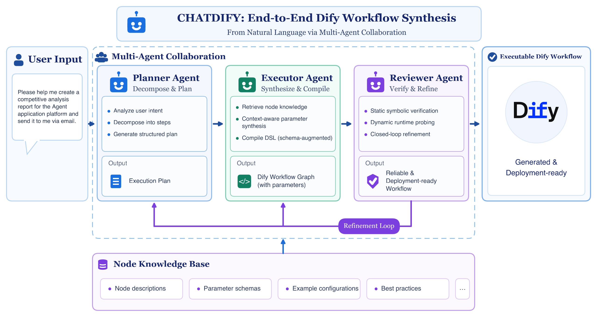

# ChatDify

<p align="center">
  <a href="https://arxiv.org/abs/2611.01563"></a>
  <a href="LICENSE"></a>
  <a href="pyproject.toml"></a>
  <a href="#upgrading-dify"></a>
  <a href="https://github.com/OpenAgentis/chatdify/stargazers"></a>
</p>

[English](README.md) | [简体中文](README_zh.md)

**ChatDify turns a natural-language request into a [Dify](https://github.com/langgenius/dify) workflow you can import.** It can also repair broken workflows and modify existing ones from an instruction.

```bash
git clone --recurse-submodules --shallow-submodules https://github.com/OpenAgentis/chatdify.git
cd chatdify && pip install -e ".[dify]"
chatdify init                                   # configure an OpenAI-compatible LLM
chatdify generate "Translate the user's text into the language they choose" -o translate.yml
```

Import `translate.yml` in Dify via **Studio → Import DSL file**.

> [!IMPORTANT]
> ChatDify is a research prototype, intended for academic research and technical exchange only. It is not recommended for direct production use. See [Disclaimer](#disclaimer).

## Features

| Command | What it does |
| --- | --- |
| `chatdify generate` | Request → workflow DSL (YAML). Supports `workflow` and `advanced-chat` apps. |
| `chatdify fix` | Repairs a DSL using static findings and an optional error message from a Dify run. |
| `chatdify modify` | Applies a natural-language change to an existing DSL. |
| `chatdify chat` | Builds and changes a workflow over a conversation: generate, modify, fix, validate and publish to your Dify. |
| `chatdify validate` | Checks DSL files against Dify's node entities, no LLM needed. Add `--dynamic` to import and run them on Dify. |
| `chatdify eval` | Runs a benchmark suite and writes per-case DSL plus a summary. |
| `chatdify dify status / fetch` | Shows or downloads the Dify source used for static validation. |

## How it works



Every command runs the same closed loop. Each round is Planner → Executor → Reviewer; when the reviewer rejects the workflow, its findings become feedback for the next round, up to `max_retries` rounds.

| Agent | Module | Does |
| --- | --- | --- |
| Planner | [`chatdify/agents/planner.py`](chatdify/agents/planner.py) | Optionally decomposes the request into sub-tasks (`generate_tasks`, off by default), retrieves a similar template (retrieval modes), selects node types and synthesises the edges |
| Executor | [`chatdify/agents/executor.py`](chatdify/agents/executor.py) | Generates each node and the conversation variables, compiles the DSL |
| Reviewer | [`chatdify/agents/reviewer.py`](chatdify/agents/reviewer.py) | Runs the workflow on Dify with generated inputs, has an LLM judge the outputs, accepts or rejects |

The loop itself is [`chatdify/agents/loop.py`](chatdify/agents/loop.py). `generate`, `fix` and `modify` each have an engine in [`chatdify/engines/`](chatdify/engines/) (`GenerateEngine`, `FixEngine`, `ModifyEngine`); they differ only in how they build each round's request: `generate` decomposes the user request, `fix` first reviews the given DSL and turns its errors into the request, `modify` turns the instruction into a change request once.

Static validation happens at two levels. While generating, the executor validates each node against Dify's entities and regenerates it up to `node_max_retries` times. The node and edge errors that remain are passed to the reviewer, which rejects the round if any are left. Without a Dify instance these static errors alone decide.

Progress is printed per agent (`[planner]`, `[executor]`, `[reviewer]`), and each result reports the time and tokens spent by each agent (`agent_stats`; `agent_totals` in eval summaries).

## Installation

Requires Python 3.11 or 3.12. For now ChatDify is installed from source only:

```bash
git clone --recurse-submodules --shallow-submodules https://github.com/OpenAgentis/chatdify.git
cd chatdify
python -m venv .venv && source .venv/bin/activate

pip install -e .              # generation only
pip install -e ".[dify]"      # + dependencies for static validation
pip install -e ".[dify,dev]"  # contributors: + test and lint tools
```

`--recurse-submodules` also fetches the Dify source used for static validation (the `dify/` submodule). If you cloned without it, run `git submodule update --init --depth 1`.

## Validation levels

ChatDify works with only an LLM key. Each further level makes the output more reliable:

| Level | Requires | Checks |
| --- | --- | --- |
| Generation only | LLM API key | Structural checks built into ChatDify |
| **Static validation** | Dify source + the `[dify]` extra | Every node is validated with Dify's own Pydantic entities, plus ChatDify's rules (variable references, types, edges, code-node conventions, ...). Failures are fed back to the LLM. |
| **Dynamic validation** | A running Dify instance (`--dify-url`) | The DSL is imported and executed with LLM-generated test inputs; runtime errors and an LLM review of the outputs are fed back. |

### Static validation: where Dify comes from

Dify is **not** bundled. ChatDify imports node definitions straight from a Dify source tree. Default version: **Dify 1.11.2**; other supported versions are listed in [Upgrading Dify](#upgrading-dify). Lookup order:

1. `--dify-src PATH` / `CHATDIFY_DIFY_SRC` / `dify_src` in the config file
2. The `dify/` git submodule (source checkouts)
3. `~/.chatdify/dify/<version>`, filled by `chatdify dify fetch`

```bash
chatdify dify fetch           # sparse git clone of dify/api (~25 MB); falls back to the release tarball
chatdify dify status          # which source is used, and whether static validation is active
```

Behind a firewall, use `--git-url <mirror>` or `--tarball-url <url-with-{version}>`.

### Upgrading Dify

Dynamic validation runs on your own Dify instance, whatever its version. Static validation uses the node definitions of the Dify source selected above, so it is best to use the same version as your instance. To switch, for example to 1.13.0:

```bash
chatdify dify fetch --version 1.13.0   # into ~/.chatdify/dify/1.13.0
# set dify_version = "1.13.0" in ~/.chatdify/config.toml (or export CHATDIFY_DIFY_VERSION=1.13.0)
chatdify dify status                   # Dify source [1.13.0], static validation: available
chatdify validate examples/dsl         # every example should pass
```

With a source checkout you can instead check out the tag in the submodule (`git -C dify fetch --depth 1 origin tag 1.13.0 && git -C dify checkout 1.13.0`) and set `dify_version` the same way.

| Dify version | Static validation |
| --- | --- |
| 1.11.x – 1.13.0 | Supported. Tested with 1.11.2 and 1.13.0 |
| 1.13.1 – 1.13.3 | Not supported yet: node definitions moved to `api/dify_graph/` |
| 1.14.0 and later | Not supported yet: node definitions moved to the separate [graphon](https://github.com/langgenius/graphon) package |

If your instance runs a version that is not supported yet, keep static validation on a supported version (the default 1.11.2, or 1.13.0) and keep dynamic validation on your instance, which still catches anything the newer Dify rejects. `chatdify dify status` says when the selected source has an unsupported layout.

Supporting a new layout is a contribution in one place: every Dify import is in [`chatdify/dify_compat/entities.py`](chatdify/dify_compat/entities.py), and the `[dify]` extra in `pyproject.toml` pins the Python dependencies from Dify's `api/pyproject.toml`. Check with `pytest` and `chatdify validate examples/dsl --dify-src <checkout>`.

### Dynamic validation

```bash
export CHATDIFY_DIFY_EMAIL=admin@example.com
export CHATDIFY_DIFY_PASSWORD=...
chatdify generate "..." --dify-url http://localhost
```

ChatDify logs in to the Dify console, imports the generated app, runs it, and asks the LLM whether the outputs satisfy the request. Use a **dedicated test workspace**: every validation creates an app there. Pass `--input-file` for workflows that need file inputs. The generated nodes call the models set by `workflow_`* (see [Workflow models](#workflow-models)); set them to models available in that workspace.

## Usage

Every command below runs from the repository root with the files in [`examples/`](examples/). DSL goes to stdout unless `-o` is given; progress goes to stderr. Generation, repair and modification each take a few minutes.

```bash
# generate from a request; --input-file is the test file used by dynamic validation
chatdify generate "Summarize the uploaded meeting notes and list the action items with owners and due dates" \
  --input-file examples/inputs/meeting_notes.md -o output/meeting_summary.yml
chatdify generate -f examples/requests.txt -o output/translate.yml

# repair, optionally passing the error you saw in Dify
chatdify fix examples/broken/text_summarization.yml \
  --feedback "code node 2: ModuleNotFoundError: No module named 'nltk'" -o output/fixed.yml

# modify
chatdify modify examples/dsl/audio_script.yml \
  "Remove the TTS step and output the generated script directly" -o output/audio_script_v2.yml

# validate files or directories (exit code 1 if any file fails; examples/broken fails on purpose)
chatdify validate examples/dsl examples/broken
chatdify validate examples/dsl/meeting_minutes.yml --dynamic --input-file examples/inputs/meeting_notes.md \
  --request "Summarize uploaded meeting notes by section, by speaker, and as action items"

# conversation, starting from an existing workflow
chatdify chat examples/dsl/audio_script.yml
```

Exit codes: `0` success, `1` generation or validation failed, `2` configuration or runtime error. Dynamic validation (`--dynamic`, and the review step of generate / fix / modify) needs a Dify instance; see [Dynamic validation](#dynamic-validation).

### Chat mode

```text
$ chatdify chat                  # new session; or: chatdify chat examples/dsl/audio_script.yml / chatdify chat --resume
chatdify> Build a workflow that translates a text into a target language
→ generate_workflow: ...
v1 ✓  1 round(s), 372s, 164012 tokens
  start(start) → translate(llm) → end(end)
chatdify[v1]> Also return the detected source language
chatdify[v2]> Which inputs does it take?
chatdify[v2]> Publish it to my Dify
Import v2 into Dify (http://localhost)? [y/N] y
  imported: http://localhost/app/<id>/workflow
```

Plain messages go to an assistant that calls tools to look at the workflow, generate, modify, fix, validate or publish it. Every generate, modify or fix call runs the full Planner → Executor → Reviewer loop and takes minutes. Instructions passed to modify include your own words and the last `chat_history_turns` instructions, so "do the same for the other branch" can be resolved. The assistant may chain at most `chat_max_tool_calls` such calls per message, then reports back.

Slash commands run without the assistant: `/show [yaml|errors|NODE]`, `/diff`, `/history`, `/undo`, `/new`, `/load FILE`, `/save [FILE]`, `/attach FILE` (test input for dynamic validation), `/generate`, `/modify`, `/fix`, `/validate [dynamic]`, `/publish [new]`, `/models`, `/quit`; `/help` lists them. Ctrl+C cancels the running step and keeps the current version.

- **Versions:** each result is a new version; `/undo` goes back to the previous one. A session lives in `~/.chatdify/sessions/<id>/` (`v1.yml`, `v2.yml`, …, `session.json`), so `--resume` continues after a restart.
- **Publishing:** the first publish asks for confirmation and creates an app in your Dify; later publishes overwrite the same app (`/publish new` creates another). With `chat_auto_publish = true`, every successful version after the first publish is synced automatically. This app is separate from the throwaway apps dynamic validation creates.
- **Tool calling:** the LLM endpoint must support OpenAI-style tool calls. If it does not, the slash commands still work.

## Configuration

`chatdify init` writes `~/.chatdify/config.toml` (file mode 600). Values are resolved in this order: command-line flags, then `CHATDIFY_*` environment variables, then `.env` in the working directory, then the config file. `chatdify config` prints the effective values with secrets masked.

A complete config looks like this (also in [`examples/config.toml`](examples/config.toml); [`examples/env.sh.example`](examples/env.sh.example) has the environment-variable form). **Replace every** `<...>` **value with your own**, and change the `workflow_`* models to ones your Dify has (see [Workflow models](#workflow-models)):

```toml
# LLM used by chatdify itself; any OpenAI-compatible endpoint works
llm_base_url = "https://open.bigmodel.cn/api/coding/paas/v4"
llm_model = "GLM-5.3-Flash"
llm_api_key = "<your-llm-api-key>"
llm_extra_body = { thinking = { type = "enabled" } }

# static validation (Dify source tree) and dynamic validation (Dify instance)
dify_static_validation = true
dify_url = "http://localhost"
dify_email = "<your-dify-email>"
dify_password = "<your-dify-password>"
dify_dynamic_validation = true

# models the generated workflow uses inside YOUR Dify; these are the defaults
[workflow_llm]
provider = "langgenius/deepseek/deepseek"
name = "deepseek-v4-flash"
mode = "chat"
completion_params = { max_tokens = 32000, temperature = 0.2, thinking = false, top_p = 0.6 }

[workflow_rerank]
provider = "langgenius/siliconflow/siliconflow"
model = "BAAI/bge-reranker-v2-m3"

[workflow_embedding]
provider = "langgenius/siliconflow/siliconflow"
model = "BAAI/bge-m3"
```

Keep this file out of version control (`chatdify init` creates it with mode 600). Without `dify_url`, dynamic validation is skipped and only static validation runs.

Providers expose reasoning switches and other non-standard parameters differently, so they all go through `llm_extra_body`, which is merged into the request body as is. As an environment variable it is JSON: `CHATDIFY_LLM_EXTRA_BODY='{"thinking": {"type": "enabled"}}'`.

| Setting (env: `CHATDIFY_` + upper case) | Default | Meaning |
| --- | --- | --- |
| `llm_model`, `llm_base_url`, `llm_api_key` | – | LLM endpoint |
| `llm_extra_body` | – | Extra parameters merged into every request body (e.g. reasoning switches) |
| `llm_proxy` | – | HTTP proxy for LLM calls |
| `generation_mode` | `AutoGen` | See below |
| `max_retries` / `node_max_retries` | 3 / 3 | Workflow-level and node-level repair rounds |
| `generate_tasks` / `expand_request` | false / false | Planner: decompose the request into sub-tasks / rewrite it in more detail first |
| `embedding_model`, `embedding_base_url`, `embedding_api_key` | – | Only for template-retrieval modes |
| `dify_src` | – | Dify source tree for static validation |
| `dify_version` | `1.11.2` | Version downloaded by `chatdify dify fetch`; preferred when several Dify checkouts are found, with a warning if the one in use differs |
| `dify_static_validation` | true | Set false to skip static validation |
| `dify_url`, `dify_email`, `dify_password` | – | Dify instance for dynamic validation |
| `dify_dynamic_validation` | true | Set false to skip dynamic validation even when `dify_url` is set |
| `dify_result_analysis` | true | LLM review of run outputs during dynamic validation |
| `home` | `~/.chatdify` | Config, logs (`logs/system.log`), caches |
| `workflow_llm`, `workflow_vision_llm`, `workflow_rerank`, `workflow_embedding` | see below | Models written into the generated workflow's nodes |
| `chat_history_turns` | 5 | `chat`: earlier instructions passed along with each change, and conversation turns the assistant sees |
| `chat_max_tool_calls` | 2 | `chat`: generate / modify / fix calls the assistant may chain per message |
| `chat_auto_publish` | false | `chat`: after the first publish, sync every successful version to the same Dify app |

### Workflow models

The `llm_*` settings are the model ChatDify itself calls. The `workflow_*` settings are different: they choose the models that the generated workflow's nodes use when it runs **inside Dify**, so they must name models that are installed and configured in your Dify workspace (**Settings → Model Provider**). Provider names follow Dify's plugin ids, e.g. `langgenius/openai/openai`; you can copy them from the `model` block of any DSL exported from your Dify.

| Setting | Used by | Default |
| --- | --- | --- |
| `workflow_llm` | LLM, Parameter Extractor and Question Classifier nodes | `deepseek-v4-flash` (`langgenius/deepseek/deepseek`), `mode = "chat"`, `completion_params = { max_tokens = 32000, temperature = 0.2, thinking = false, top_p = 0.6 }` |
| `workflow_vision_llm` | LLM nodes with vision enabled | same as `workflow_llm` |
| `workflow_rerank` | Knowledge Retrieval reranking | `BAAI/bge-reranker-v2-m3` (`langgenius/siliconflow/siliconflow`) |
| `workflow_embedding` | Knowledge Retrieval vector weights | `BAAI/bge-m3` (`langgenius/siliconflow/siliconflow`) |

```toml
[workflow_llm]
provider = "langgenius/openai/openai"
name = "gpt-4o"
completion_params = { temperature = 0.3, max_tokens = 4096 }

[workflow_vision_llm]   # only the keys that differ from workflow_llm
name = "gpt-4o-mini"

[workflow_rerank]
provider = "langgenius/cohere/cohere"
model = "rerank-multilingual-v3.0"

[workflow_embedding]
provider = "langgenius/openai/openai"
model = "text-embedding-3-small"
```

Keys you set replace the default's keys of the same name and the rest keep their defaults; a `completion_params` table replaces all default parameters. As environment variables these are JSON, e.g. `CHATDIFY_WORKFLOW_LLM='{"provider": "langgenius/openai/openai", "name": "gpt-4o"}'`. These values override whatever model the LLM wrote into a node. `chatdify dify status` lists the models in effect, and `generate` / `fix` / `modify` / `eval` print a reminder while any of them is still a default. If dynamic validation fails with a model or provider error, check these settings first.

### Generation modes

| Mode | Strategy | Needs embeddings |
| --- | --- | --- |
| `AutoGen` (default) | Plan the graph, then generate each node from the node reference knowledge base | no |
| `ZeroShot` | One LLM call emits the full DSL | no |
| `MixedGen` | Retrieve a similar template, then AutoGen guided by it | yes |
| `AutoRec` | Retrieve and reuse the closest template | yes |
| `AutoRecZeroShot` | Retrieve a template, then ZeroShot with it as context | yes |

## Evaluation

The benchmark suites live in [`test_cases/chatdify/`](test_cases/chatdify/): `workflow_test_cases_large.yaml` (100 generation cases), `_small` (16) and `_tiny` (5) for quick runs, and `workflow_test_cases_bugfix.yaml` (24 repair cases, DSL in `bugfix_dsl/`). Input files are in `data/`.

```bash
chatdify eval generation test_cases/chatdify/workflow_test_cases_tiny.yaml --dify-url http://localhost   # try first
chatdify eval generation test_cases/chatdify/workflow_test_cases_large.yaml \
  --dify-url http://localhost -o eval_results
chatdify eval bugfix test_cases/chatdify/workflow_test_cases_bugfix.yaml --dify-url http://localhost
```

Each run writes `results.jsonl`, `summary.yml` and the generated DSL under `eval_results/<task>_<timestamp>/`. `summary.yml` has a `by_round` table: success rate, average time and average tokens per case if every case had been allowed at most N rounds (N = 1 … `max_retries`). Per-round details for each case are in the `rounds` field of `results.jsonl`. Token counts include `cached_tokens`, the part of the input served from the provider's prompt cache; `cache_hit_rate` (cached / input, in %) is reported overall, per agent and per N. Providers that do not report cache hits show 0.

## Project layout

```
chatdify/
├── cli.py, api.py        # command line interface and its programmatic backend
├── engines/              # one engine per command: generate.py, fix.py, modify.py
├── agents/               # Planner, Executor, Reviewer and the refinement loop
├── chat/                 # `chatdify chat`: session (versions, persistence), tool-calling assistant, terminal loop
├── core/                 # components used by the agents: node & edge managers, validators, retrieval
│   └── node_validator/   # per-node static validators built on Dify entities
├── dify_compat/          # locating Dify, importing its node entities, `dify fetch`
├── kg/                   # knowledge base: node references, workflow templates
├── prompts/  models/  services/  evaluation/  utils/
dify/                     # git submodule: langgenius/dify @ 1.11.2 (not packaged)
examples/  test_cases/  tests/
```

## Citation

```bibtex
@article{fan2026chatdify,
  title={CHATDIFY: Automating End-to-End Dify Workflow Synthesis from Natural Language via Multi-Agent Collaboration},
  author={Fan, Tao and Ma, Guoqiang},
  journal={arXiv preprint arXiv:2611.01563},
  year={2026}
}
```

## Disclaimer

ChatDify is a research prototype, intended for academic research and technical exchange only. It is not recommended for direct production use.

- **Provided "as is".** This project is provided under the Apache License 2.0 on an "AS IS" basis, without warranties or conditions of any kind, express or implied, including warranties of merchantability, fitness for a particular purpose and non-infringement. To the maximum extent permitted by applicable law, the authors and contributors are not liable for any direct or indirect damages arising from its use.
- **Review everything it generates.** Workflows are generated by an LLM and may be incorrect, incomplete or unsafe; their code nodes and HTTP requests can run arbitrary code and reach external services. Passing ChatDify's validation does not mean a workflow meets your business, security or compliance requirements.
- **Assess before production use.** If you use this project or the workflows it generates in production, you are responsible for functional testing, security assessment and hardening (for example code review, least privilege, network isolation, secret management, log redaction and access control), and for complying with the laws, regulations and data-protection rules of your jurisdiction and industry. You do so at your own risk.
- **Data and third-party services.** Requests, workflow content and test files are sent to the LLM provider you configure, and dynamic validation creates and runs apps in your Dify instance. Do not submit personal, confidential or regulated data, and follow the terms of the services you use. See [SECURITY.md](SECURITY.md) for operational security notes.
- **Not affiliated with Dify.** This is an independent project, not affiliated with, endorsed by or sponsored by LangGenius or Dify. Dify is a trademark of its owner.
- **No institutional endorsement.** This project reflects the authors' own views only, not those of their employers or affiliated institutions, and is not an officially released or supported product of any organization.

## License

Apache License 2.0, see [LICENSE](LICENSE). Dify is licensed separately under the [Dify Open Source License](https://github.com/langgenius/dify/blob/main/LICENSE) and is not redistributed with this package; see [NOTICE](NOTICE).
