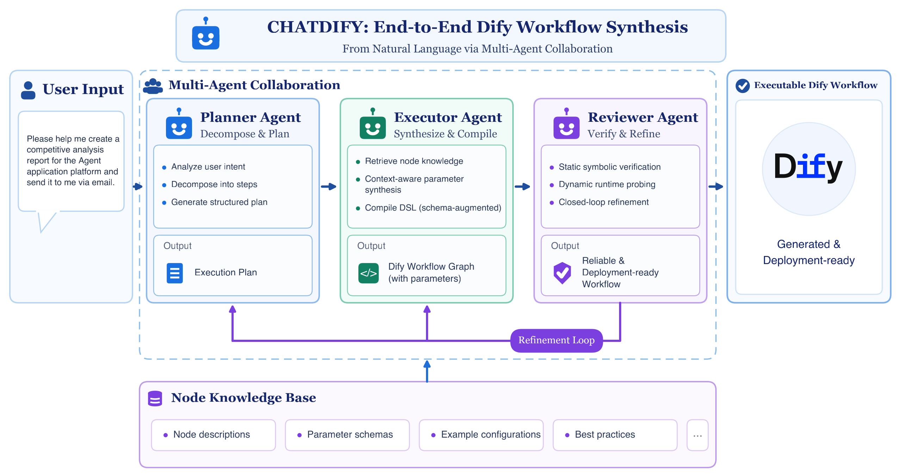

# ChatDify

<p align="center">
  <a href="https://arxiv.org/abs/2611.01563"></a>
  <a href="LICENSE"></a>
  <a href="pyproject.toml"></a>
  <a href="#升级-dify"></a>
  <a href="https://github.com/OpenAgentis/chatdify/stargazers"></a>
</p>

[English](README.md) | 简体中文

**ChatDify 把一句自然语言需求变成可直接导入 [Dify](https://github.com/langgenius/dify) 的工作流**，也能修复出错的工作流、按指令修改已有工作流。

```bash
git clone --recurse-submodules --shallow-submodules https://github.com/OpenAgentis/chatdify.git
cd chatdify && pip install -e ".[dify]"
chatdify init                                   # 配置任意 OpenAI 兼容的大模型
chatdify generate "把用户输入的文本翻译成指定语言的文本" -o translate.yml
```

在 Dify 中通过 **工作室 → 导入 DSL 文件** 导入 `translate.yml`。

> [!IMPORTANT]
> 本项目是研究原型，仅供学术研究和技术交流使用，不建议直接用于生产环境。详见[免责声明](#免责声明)。

## 功能

| 命令 | 作用 |
| --- | --- |
| `chatdify generate` | 需求 → 工作流 DSL（YAML），支持 `workflow` 与 `advanced-chat` |
| `chatdify fix` | 结合静态校验结果和（可选的）Dify 运行报错修复 DSL |
| `chatdify modify` | 按自然语言指令修改已有 DSL |
| `chatdify chat` | 在对话中生成、修改、修复、校验工作流，并发布到你的 Dify |
| `chatdify validate` | 用 Dify 节点实体校验 DSL，无需大模型；加 `--dynamic` 则导入 Dify 实际运行 |
| `chatdify eval` | 批量评测，输出每个用例的 DSL 与汇总 |
| `chatdify dify status / fetch` | 查看 / 下载静态校验所用的 Dify 源码 |

## 工作原理




所有命令都运行同一个闭环：每一轮依次执行 Planner → Executor → Reviewer；Reviewer 不通过时，它的评审意见作为下一轮的反馈，最多 `max_retries` 轮。

| Agent | 模块 | 职责 |
| --- | --- | --- |
| Planner | [`chatdify/agents/planner.py`](chatdify/agents/planner.py) | 可选地把需求分解为子任务（`generate_tasks`，默认关闭），检索相似模板（检索类模式），选择节点类型并生成连线 |
| Executor | [`chatdify/agents/executor.py`](chatdify/agents/executor.py) | 逐个生成节点和会话变量，编译出 DSL |
| Reviewer | [`chatdify/agents/reviewer.py`](chatdify/agents/reviewer.py) | 用生成的测试输入在 Dify 上运行工作流，由大模型评判输出，决定通过或打回 |

闭环本身在 [`chatdify/agents/loop.py`](chatdify/agents/loop.py)。`generate`、`fix`、`modify` 各有一个引擎，在 [`chatdify/engines/`](chatdify/engines/)（`GenerateEngine`、`FixEngine`、`ModifyEngine`），它们的区别只在于每轮需求怎么来：`generate` 分解用户需求；`fix` 先评审一遍给定的 DSL，把错误转成需求；`modify` 一次性把修改指令转成修改需求。

静态校验分两层：生成过程中，Executor 对每个节点用 Dify 实体校验，不通过就重新生成，最多 `node_max_retries` 次；仍然存在的节点和连线错误交给 Reviewer，有残留错误这一轮就不通过。没有 Dify 实例时，只由这些静态错误决定。

进度按 agent 输出（`[planner]`、`[executor]`、`[reviewer]`），每个结果都会给出各 agent 的耗时和 token 用量（`agent_stats`；eval 汇总里是 `agent_totals`）。

## 安装

需要 Python 3.11 或 3.12。目前仅支持源码安装：

```bash
git clone --recurse-submodules --shallow-submodules https://github.com/OpenAgentis/chatdify.git
cd chatdify
python -m venv .venv && source .venv/bin/activate

pip install -e .            # 仅生成
pip install -e ".[dify]"    # 加装静态校验所需依赖
pip install -e ".[dify,dev]"  # 参与开发：再加测试与 lint 工具
```

`--recurse-submodules` 会一并拉取静态校验所用的 Dify 源码（`dify/` 子模块）；克隆时漏掉的话，执行 `git submodule update --init --depth 1` 补上。

## 三档校验

只有大模型 Key 也能用；每多一档，结果更可靠：

| 档位 | 需要 | 校验内容 |
| --- | --- | --- |
| 仅生成 | 大模型 API Key | ChatDify 内置的结构检查 |
| **静态校验** | Dify 源码 + `[dify]` 依赖 | 用 Dify 自身的 Pydantic 实体校验每个节点，加上 ChatDify 的规则（变量引用、类型、连线、code 节点约定等），失败信息回传大模型重试 |
| **动态校验** | 运行中的 Dify（`--dify-url`） | 导入并用大模型生成的测试输入运行，运行错误与大模型对输出的评审回传重试 |

### 静态校验：Dify 源码从哪来

ChatDify **不打包** Dify，而是直接从 Dify 源码目录导入节点定义。默认版本为 **Dify 1.11.2**，其他支持的版本见[升级 Dify](#升级-dify)。查找顺序：

1. `--dify-src PATH` / `CHATDIFY_DIFY_SRC` / 配置文件中的 `dify_src`
2. 仓库内的 `dify/` git submodule（源码安装）
3. `chatdify dify fetch` 下载到的 `~/.chatdify/dify/<version>`

```bash
chatdify dify fetch           # 稀疏克隆 dify/api（约 25 MB），失败时回退到 release 压缩包
chatdify dify status          # 查看使用哪份源码、静态校验是否生效
```

网络受限时可用 `--git-url <镜像地址>` 或 `--tarball-url <含 {version} 的地址>`。

### 升级 Dify

动态校验在你自己的 Dify 实例上运行，与实例版本无关。静态校验使用上面选中的 Dify 源码中的节点定义，最好与实例保持同一版本。以切换到 1.13.0 为例：

```bash
chatdify dify fetch --version 1.13.0   # 下载到 ~/.chatdify/dify/1.13.0
# 在 ~/.chatdify/config.toml 中设置 dify_version = "1.13.0"（或 export CHATDIFY_DIFY_VERSION=1.13.0）
chatdify dify status                   # 应显示 Dify source [1.13.0]、static validation: available
chatdify validate examples/dsl         # 示例应全部通过
```

源码安装时也可以在 submodule 中切换到对应 tag（`git -C dify fetch --depth 1 origin tag 1.13.0 && git -C dify checkout 1.13.0`），同样设置 `dify_version`。

| Dify 版本 | 静态校验 |
| --- | --- |
| 1.11.x – 1.13.0 | 支持，已在 1.11.2 和 1.13.0 上测试 |
| 1.13.1 – 1.13.3 | 暂不支持：节点定义移到了 `api/dify_graph/` |
| 1.14.0 及以上 | 暂不支持：节点定义拆分为独立的 [graphon](https://github.com/langgenius/graphon) 包 |

如果实例的版本暂不支持，静态校验继续使用已支持的版本（默认的 1.11.2，或 1.13.0），动态校验仍连你的实例，新版 Dify 不接受的内容会在动态校验中发现。所选源码的结构不受支持时，`chatdify dify status` 会给出提示。

适配新的代码结构只需改一处：所有 Dify 导入都在 [`chatdify/dify_compat/entities.py`](chatdify/dify_compat/entities.py) 中，`pyproject.toml` 的 `[dify]` 依赖按 Dify 的 `api/pyproject.toml` 固定版本。改完用 `pytest` 和 `chatdify validate examples/dsl --dify-src <源码目录>` 检查。

### 动态校验

```bash
export CHATDIFY_DIFY_EMAIL=admin@example.com
export CHATDIFY_DIFY_PASSWORD=...
chatdify generate "..." --dify-url http://localhost
```

ChatDify 会登录 Dify 控制台、导入生成的应用并运行，再让大模型判断输出是否满足需求。每次校验都会新建一个应用，请使用**专门的测试工作空间**。需要文件输入的工作流用 `--input-file` 传入测试文件。生成的节点调用 `workflow_`* 配置的模型（见[工作流中的模型](#工作流中的模型)），请设为该工作空间中可用的模型。

## 使用

以下命令都在仓库根目录运行，用到的文件都在 [`examples/`](examples/) 中。DSL 默认输出到 stdout（`-o` 写文件），进度输出到 stderr。生成、修复、修改每次需要几分钟。

```bash
# 生成：--input-file 是动态校验用的测试文件
chatdify generate "总结上传的会议纪要，并列出待办事项及负责人和截止日期" \
  --input-file examples/inputs/meeting_notes.md -o output/meeting_summary.yml
chatdify generate -f examples/requests.txt -o output/translate.yml

# 修复，可附上在 Dify 中看到的报错
chatdify fix examples/broken/text_summarization.yml \
  --feedback "code 节点 2: ModuleNotFoundError: No module named 'nltk'" -o output/fixed.yml

# 修改
chatdify modify examples/dsl/audio_script.yml "去掉 TTS 音频转换这一步，直接输出生成的脚本" \
  -o output/audio_script_v2.yml

# 校验文件或目录（有失败时退出码为 1；examples/broken 是故意不通过的）
chatdify validate examples/dsl examples/broken
chatdify validate examples/dsl/meeting_minutes.yml --dynamic --input-file examples/inputs/meeting_notes.md \
  --request "上传会议纪要，按章节、按发言人总结，并整理行动项"

# 对话模式，从已有工作流开始
chatdify chat examples/dsl/audio_script.yml
```

退出码：`0` 成功，`1` 生成或校验未通过，`2` 配置或运行错误。动态校验（`--dynamic`，以及 generate / fix / modify 中的评审步骤）需要 Dify 实例，见[动态校验](#动态校验)。

### 对话模式

```text
$ chatdify chat                  # 新会话；也可以 chatdify chat examples/dsl/audio_script.yml / chatdify chat --resume
chatdify> 做一个翻译工作流，输入文本和目标语言
→ generate_workflow: ...
v1 ✓  1 round(s), 372s, 164012 tokens
  开始(start) → 翻译(llm) → 结束(end)
chatdify[v1]> 再输出识别到的源语言
chatdify[v2]> 它需要哪些输入？
chatdify[v2]> 发布到我的 Dify
Import v2 into Dify (http://localhost)? [y/N] y
  imported: http://localhost/app/<id>/workflow
```

普通的话交给对话助手，它通过工具查看、生成、修改、修复、校验或发布工作流。每次生成、修改、修复都会完整跑一遍 Planner → Executor → Reviewer，需要几分钟。传给修改的指令会带上你的原话和最近 `chat_history_turns` 条指令，所以"另一个分支也这样改"这类指代能被理解。每条消息里，助手最多连续调用 `chat_max_tool_calls` 次这类操作，然后停下来汇报。

斜杠命令不经过助手直接执行：`/show [yaml|errors|节点]`、`/diff`、`/history`、`/undo`、`/new`、`/load 文件`、`/save [文件]`、`/attach 文件`（动态校验的测试文件）、`/generate`、`/modify`、`/fix`、`/validate [dynamic]`、`/publish [new]`、`/models`、`/quit`；`/help` 可以查看全部。按 Ctrl+C 取消正在运行的步骤，当前版本不变。

- **版本：** 每次结果都是一个新版本，`/undo` 回到上一版。会话保存在 `~/.chatdify/sessions/<id>/`（`v1.yml`、`v2.yml`……和 `session.json`），重启后用 `--resume` 继续。
- **发布：** 第一次发布前会确认，然后在你的 Dify 中新建应用；之后的发布覆盖同一个应用（`/publish new` 另建一个）。设置 `chat_auto_publish = true` 后，首次发布之后每个成功的版本都会自动同步。这个应用和动态校验时临时创建的应用是分开的。
- **工具调用：** 大模型接口需要支持 OpenAI 风格的工具调用；不支持时斜杠命令仍可使用。

## 配置

`chatdify init` 写入 `~/.chatdify/config.toml`（权限 600）。优先级：命令行参数 > `CHATDIFY_*` 环境变量 > 当前目录 `.env` > 配置文件。`chatdify config` 可查看生效配置（密钥已打码）。

完整配置如下（同 [`examples/config.toml`](examples/config.toml)；环境变量写法见 [`examples/env.sh.example`](examples/env.sh.example)）。**请把所有** `<...>` **换成你自己的值**，并把 `workflow_`* 改成你的 Dify 中已有的模型（见[工作流中的模型](#工作流中的模型)）：

```toml
# ChatDify 自己调用的大模型，支持任意 OpenAI 兼容接口
llm_base_url = "https://open.bigmodel.cn/api/coding/paas/v4"
llm_model = "GLM-5.3-Flash"
llm_api_key = "<your-llm-api-key>"
llm_extra_body = { thinking = { type = "enabled" } }

# 静态校验（Dify 源码）与动态校验（Dify 实例）
dify_static_validation = true
dify_url = "http://localhost"
dify_email = "<your-dify-email>"
dify_password = "<your-dify-password>"
dify_dynamic_validation = true

# 生成的工作流在【你的 Dify】中使用的模型；以下为默认值
[workflow_llm]
provider = "langgenius/deepseek/deepseek"
name = "deepseek-v4-flash"
mode = "chat"
completion_params = { max_tokens = 32000, temperature = 0.2, thinking = false, top_p = 0.6 }

[workflow_rerank]
provider = "langgenius/siliconflow/siliconflow"
model = "BAAI/bge-reranker-v2-m3"

[workflow_embedding]
provider = "langgenius/siliconflow/siliconflow"
model = "BAAI/bge-m3"
```

该文件含密钥，不要提交到版本库（`chatdify init` 生成时权限为 600）。不配置 `dify_url` 时跳过动态校验，只做静态校验。

各家接口开启深度思考等非标准参数的写法不同，统一通过 `llm_extra_body` 原样合并进请求体；用环境变量时写成 JSON：`CHATDIFY_LLM_EXTRA_BODY='{"thinking": {"type": "enabled"}}'`。

| 配置项（环境变量：`CHATDIFY_` + 大写） | 默认 | 说明 |
| --- | --- | --- |
| `llm_model`、`llm_base_url`、`llm_api_key` | – | 大模型接口 |
| `llm_extra_body` | – | 合并进每次请求体的额外参数（如深度思考开关） |
| `llm_proxy` | – | 大模型调用的 HTTP 代理 |
| `generation_mode` | `AutoGen` | 见下表 |
| `max_retries` / `node_max_retries` | 3 / 3 | 工作流级 / 节点级修复轮数 |
| `generate_tasks` / `expand_request` | false / false | Planner：把需求分解为子任务 / 先把需求改写得更详细 |
| `embedding_model`、`embedding_base_url`、`embedding_api_key` | – | 仅模版检索类模式需要 |
| `dify_src` | – | 静态校验所用 Dify 源码 |
| `dify_version` | `1.11.2` | `chatdify dify fetch` 下载的版本；找到多份 Dify 源码时优先用此版本，实际版本不一致时给出警告 |
| `dify_static_validation` | true | 设为 false 跳过静态校验 |
| `dify_url`、`dify_email`、`dify_password` | – | 动态校验所用 Dify 实例 |
| `dify_dynamic_validation` | true | 设为 false 时即使配置了 `dify_url` 也跳过动态校验 |
| `dify_result_analysis` | true | 动态校验时由大模型评审运行输出 |
| `home` | `~/.chatdify` | 配置、日志（`logs/system.log`）、缓存 |
| `workflow_llm`、`workflow_vision_llm`、`workflow_rerank`、`workflow_embedding` | 见下文 | 写入生成的工作流节点的模型 |
| `chat_history_turns` | 5 | `chat`：每次修改附带的历史指令条数，也是助手能看到的对话轮数 |
| `chat_max_tool_calls` | 2 | `chat`：每条消息中助手最多连续调用生成/修改/修复的次数 |
| `chat_auto_publish` | false | `chat`：首次发布后，每个成功的版本自动同步到同一个 Dify 应用 |

### 工作流中的模型

`llm_*` 是 ChatDify 自己调用的模型；`workflow_*` 不同，它决定生成的工作流**在 Dify 中运行时**各节点使用的模型，因此必须是你的 Dify 工作空间里已安装并配置好的模型（**设置 → 模型供应商**）。provider 使用 Dify 的插件 ID，如 `langgenius/openai/openai`，可以从你的 Dify 导出的任意 DSL 的 `model` 字段中复制。

| 配置项 | 作用于 | 默认 |
| --- | --- | --- |
| `workflow_llm` | LLM、参数提取、问题分类节点 | `deepseek-v4-flash`（`langgenius/deepseek/deepseek`），`mode = "chat"`，`completion_params = { max_tokens = 32000, temperature = 0.2, thinking = false, top_p = 0.6 }` |
| `workflow_vision_llm` | 开启视觉的 LLM 节点 | 同 `workflow_llm` |
| `workflow_rerank` | 知识检索的重排序模型 | `BAAI/bge-reranker-v2-m3`（`langgenius/siliconflow/siliconflow`） |
| `workflow_embedding` | 知识检索的向量权重 | `BAAI/bge-m3`（`langgenius/siliconflow/siliconflow`） |

```toml
[workflow_llm]
provider = "langgenius/openai/openai"
name = "gpt-4o"
completion_params = { temperature = 0.3, max_tokens = 4096 }

[workflow_vision_llm]   # 只写与 workflow_llm 不同的键
name = "gpt-4o-mini"

[workflow_rerank]
provider = "langgenius/cohere/cohere"
model = "rerank-multilingual-v3.0"

[workflow_embedding]
provider = "langgenius/openai/openai"
model = "text-embedding-3-small"
```

写了的键替换默认值中的同名键，没写的保留默认值；写了 `completion_params` 表则整体替换默认参数。用环境变量时写成 JSON，如 `CHATDIFY_WORKFLOW_LLM='{"provider": "langgenius/openai/openai", "name": "gpt-4o"}'`。这些配置会覆盖大模型写进节点的模型。`chatdify dify status` 列出当前生效的模型；只要还有使用默认值的，`generate` / `fix` / `modify` / `eval` 都会提示。动态校验报模型或供应商相关错误时，先检查这里。

### 生成模式

| 模式 | 策略 | 需要嵌入模型 |
| --- | --- | --- |
| `AutoGen`（默认） | 先规划图，再依据节点参考知识库逐节点生成 | 否 |
| `ZeroShot` | 一次调用直接输出完整 DSL | 否 |
| `MixedGen` | 检索相似模版，再以其为约束走 AutoGen | 是 |
| `AutoRec` | 检索并复用最接近的模版 | 是 |
| `AutoRecZeroShot` | 检索模版后作为上下文 ZeroShot 生成 | 是 |

## 评测

评测集位于 [`test_cases/chatdify/`](test_cases/chatdify/)：`workflow_test_cases_large.yaml`（100 个生成用例）、`_small`（16 个）和 `_tiny`（5 个）用于快速试跑，`workflow_test_cases_bugfix.yaml`（24 个修复用例，DSL 在 `bugfix_dsl/`）。输入文件在 `data/`。

```bash
chatdify eval generation test_cases/chatdify/workflow_test_cases_tiny.yaml --dify-url http://localhost   # 先试跑
chatdify eval generation test_cases/chatdify/workflow_test_cases_large.yaml \
  --dify-url http://localhost -o eval_results
chatdify eval bugfix test_cases/chatdify/workflow_test_cases_bugfix.yaml --dify-url http://localhost
```

每次运行在 `eval_results/<task>_<时间戳>/` 下生成 `results.jsonl`、`summary.yml` 和所有 DSL。`summary.yml` 里的 `by_round` 给出"每个用例最多允许跑 N 轮"（N = 1 … `max_retries`）时的成功率、平均耗时和平均 token；每个用例的逐轮明细在 `results.jsonl` 的 `rounds` 字段。token 统计包含 `cached_tokens`，即输入中命中提供方提示词缓存的部分；`cache_hit_rate`（缓存命中 / 输入，百分比）分别给出总体、各 agent 和各 N 的数值，不报告缓存命中的接口记为 0。

## 目录结构

```
chatdify/
├── cli.py, api.py        # 命令行及其编程接口
├── engines/              # 每个命令一个引擎：generate.py、fix.py、modify.py
├── agents/               # Planner、Executor、Reviewer 及闭环
├── chat/                 # chatdify chat：会话（版本、持久化）、工具调用助手、终端交互
├── core/                 # agent 使用的组件：节点与连线管理、校验器、检索
│   └── node_validator/   # 基于 Dify 实体的节点静态校验
├── dify_compat/          # 定位 Dify、导入节点实体、dify fetch
├── kg/                   # 知识库：节点参考、工作流模版
├── prompts/  models/  services/  evaluation/  utils/
dify/                     # git submodule：langgenius/dify @ 1.11.2（不打包）
examples/  test_cases/  tests/
```

## 引用

```bibtex
@article{fan2026chatdify,
  title={CHATDIFY: Automating End-to-End Dify Workflow Synthesis from Natural Language via Multi-Agent Collaboration},
  author={Fan, Tao and Ma, Guoqiang},
  journal={arXiv preprint arXiv:2611.01563},
  year={2026}
}
```

## 免责声明

本项目是研究原型，仅供学术研究和技术交流使用，不建议直接用于生产环境。

- **按"现状"提供。** 本项目依据 Apache License 2.0 按"现状"（AS IS）提供，不附带任何明示或暗示的担保，包括但不限于适销性、特定用途适用性和不侵权的担保。在适用法律允许的最大范围内，作者和贡献者不对因使用本项目而产生的任何直接或间接损失承担责任。
- **生成内容须人工审核。** 工作流由大模型生成，可能不正确、不完整或不安全；其中的代码节点和 HTTP 请求可能执行任意代码或访问外部服务。通过 ChatDify 的校验，不代表工作流满足你的业务、安全或合规要求。
- **用于生产前请自行评估。** 如需在生产环境中使用本项目或其生成的工作流，请自行完成功能测试、安全评估和安全加固，例如代码审查、最小权限、网络隔离、密钥管理、日志脱敏和访问控制，并确保符合所在地区和行业的法律法规及数据保护要求。由此产生的风险由使用者自行承担。
- **数据与第三方服务。** 需求描述、工作流内容和测试文件会发送给你配置的大模型服务；动态校验会在你的 Dify 实例中创建并运行应用。请勿提交个人敏感信息、商业秘密或受监管的数据，并遵守相关服务的使用条款。运行时的安全注意事项见 [SECURITY.md](SECURITY.md)。
- **与 Dify 无关联。** 本项目是独立项目，与 LangGenius 及 Dify 官方没有关联，也未获其认可或赞助。Dify 是其所有者的商标。
- **不代表任何机构。** 本项目仅代表作者个人观点，不代表作者所在机构的立场，也不是任何机构正式发布或支持的产品。

## 许可证

Apache License 2.0，见 [LICENSE](LICENSE)。Dify 遵循其自身的 [Dify Open Source License](https://github.com/langgenius/dify/blob/main/LICENSE)，本项目不分发 Dify 代码，详见 [NOTICE](NOTICE)。
